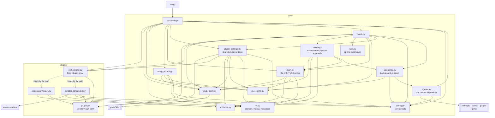
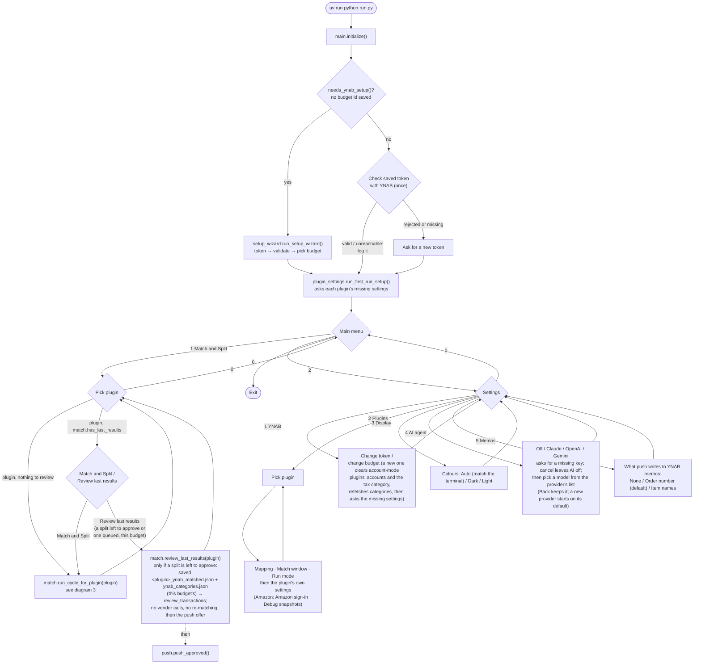
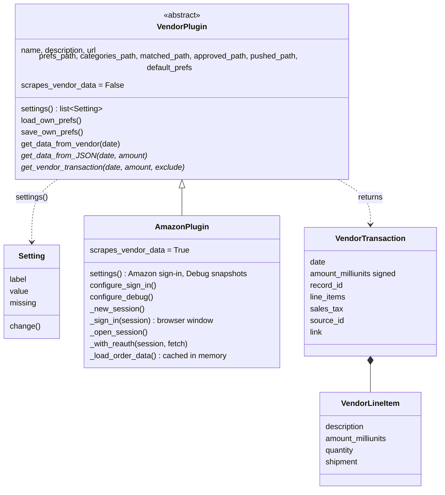
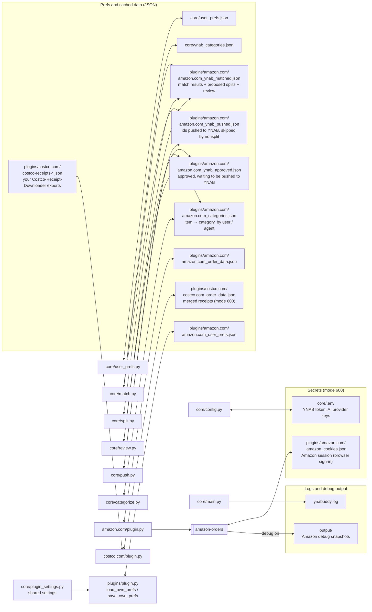

# YNABuddy — Code Diagrams

Diagrams of the app code (`run.py`, `core/`, `plugins/`). Devtools and tests
are left out.

## 1. Module dependencies

Who imports whom. The plugin SDK (`plugins/plugin.py`) imports nothing from
`core`: it's only the contract. The settings every plugin shares live in
`core/plugin_settings.py`. Individual plugins still use core's helper
modules (`config`, `ui`, `milliunits`).



## 2. Program flow (startup and menus)



## 3. Match cycle

What `match.run_cycle_for_plugin(plugin)` does for the plugin picked from
the Match and Split menu. It adds proposed splits to
`<plugin>_ynab_matched.json` (e.g. `amazon.com_ynab_matched.json`, overwritten on each run
of that plugin), shows them for review, and pushes the approved ones to
YNAB.

```mermaid
sequenceDiagram
    participant M as match.py
    participant Y as ynab_client
    participant P as plugin (Amazon)
    participant A as Amazon
    participant S as split.py
    participant R as review.py
    participant C as categorize.py (thread)
    participant Q as push.py

    alt plugin_settings.needs_setup(plugin)
        M->>M: log "setup incomplete", run nothing
    end
    M->>Y: list_categories()
    Y-->>M: categories → ynab_categories.json<br/>(saved ones another budget's: plugin category tables<br/>first move to the same-named categories, categorize.follow_budget)

    M->>Y: list_transactions(unapproved_only = run_mode == "unapproved")
    Y-->>M: transactions
    M->>M: keep candidates matching the plugin's account or payee<br/>(nonsplit mode: drop already-split ones<br/>and the ids in amazon.com_ynab_pushed.json)

    opt plugin.scrapes_vendor_data and candidates exist
        M->>P: get_data_from_vendor(earliest candidate − lookback margin)
        P->>A: reuse saved session or log in
        P->>A: order history + card charges
        A-->>P: orders, charges
        P->>P: merge into amazon.com_order_data.json<br/>(Whole Foods receipt charges linked to their order)
        P->>A: each charged order not on file: get_order (D01-, older),<br/>Amazon Pay page (P01-); a failure is retried next scrape
        Note over M,P: a scrape failure is logged,<br/>matching uses data already on disk
    end

    loop each candidate transaction
        loop each date within ± match window (global, default 5 days), closest first
            M->>P: get_vendor_transaction(date, signed amount, exclude = claimed + found)
            P-->>M: a charge on that date for that amount, else an order<br/>with no charges and that grand_total, or None (asked again until None)
        end
        M->>M: closest record → claimed, matched (1 fit) / ambiguous (2+) /<br/>unmatched with a reason (none fit, or all fits claimed)
    end
    M->>M: write amazon.com_ynab_matched.json (transactions + match_status,<br/>match_reason, vendor_match), a plugin error keeps the results so far

    M->>S: split_transactions(amazon.com_ynab_matched.json, tax pref)
    S->>S: each matched/ambiguous transaction: pick the charged items<br/>(all, or the shipments that add up to a part-charge),<br/>spread the amount over them (tax too, unless its own line)
    S->>S: add split_status (exact / approximate / nothing to split),<br/>split_reason, split_lines; save the file

    M->>R: review_transactions(amazon.com_ynab_matched.json, categories,<br/>ask = the chosen provider, None if AI is off or its key is missing)
    opt ask and items with no table entry (not "Sales tax"; each name once)
        R-)C: start: first 10 transactions' items one call each,<br/>then 100 transactions' items per call
        C->>C: each call: agents.ask_*, write valid answers as "agent"<br/>(unless the item got an entry meanwhile), save the table;<br/>a failed call leaves its items "(none)"
        Note over C: messages to the log and queue only,<br/>shown when the review screen redraws
    end
    loop each split transaction not yet approved, newest first, until [q]
        R->>R: if its items are pending: "Waiting for Agent suggestions..."<br/>until answered or failed
        R->>R: fill uncategorized lines from the plugin's category table
        R->>R: one screen, one option per line: [a] approve (every line categorized),<br/>[e] edit category (line, then category with autocomplete), [s] skip,<br/>[p] previous (to the previous transaction of this review, its outcome in the header;<br/>puts back this screen's changes),<br/>[m] merge (lines of one category into one, memos joined),<br/>[d] divide (a line, or the whole amount, into two halves),<br/>[u] undo (this screen's last [e], [d] or [m], in memory only),<br/>[o] open order in browser (vendor_match.link), [q] quit (on one approved earlier: puts them back too)
        R->>Q: on [a]: queue(amazon.com_ynab_approved.json) -- id, budget,<br/>date, amount, split lines or whole category,<br/>order number; replaces an earlier entry
        R->>Q: on [s] of one approved earlier: unqueue(amazon.com_ynab_approved.json, id)
    end
    R->>R: save review_status (+ categories) into the file,<br/>and the category table ([e] and [a] set "user";<br/>a merged line's items, on [a] only);<br/>the agent stops after its current call, writing nothing more

    M->>Q: push_approved(amazon.com_ynab_approved.json,<br/>amazon.com_ynab_pushed.json, selected budget)
    Q->>Q: entries for another budget stay queued (one message);<br/>"Push N approved transaction(s) to YNAB? (y/n)" -- no: all stay queued
    Q->>Y: list_transactions(since earliest queued date), list_categories()
    Q->>Y: get_transaction(id) for each queued one not in that list
    Q->>Q: deleted / missing / already split: dropped from the queue;<br/>date or amount changed, or a category gone: flagged, leaves the queue
    Q->>Y: update_transactions(batch) -- one PATCH per ≤ 500 KB of JSON:<br/>approved + subtransactions (amount, category, memo; no payee),<br/>or one line: approved + its category, or approved + whole category;<br/>never a payee_id, even from an entry queued before [p] was removed; memos by Settings > Memos:<br/>order number on the transaction, or item names (not a merged line's),<br/>or none; a memo already in YNAB is never overwritten
    Y-->>Q: ids saved → removed from the queue, added to amazon.com_ynab_pushed.json;<br/>an error keeps the rest (one bad item fails its whole PATCH, nothing saved)
```

## 4. Plugin SDK classes



`*` = abstract; every plugin must implement it.

The plugin settings menu, the Settings overview and first-run setup are all
built from `core/plugin_settings.all_settings(plugin)`: the shared settings
(Mapping, Match window, Run mode) followed by the plugin's own
`settings()`. Each `Setting` is shown as `label: value`, picking it calls
`change()`, and first-run setup asks every setting marked `missing`.

## 5. Data files

Which code reads and writes each file. All of them are per-install and
gitignored.



Matching uses the Amazon charges first; an order's `grand_total` is only
used for orders with no charge on file. The match window (`match_window_days`)
is one global setting in `core/user_prefs.json`.
